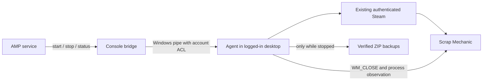

# Scrap Mechanic Survival host for AMP on Windows

A custom AMP Generic Module template plus a small C#/.NET companion for an
existing licensed Steam installation. **Community review prototype: Windows
build/native tests, AMP startup, multiplayer, graceful stop, stopped backups,
scheduled restart and one valid persistence trial passed. Extended acceptance
tests remain open.** No SteamCMD server,
game download, credentials, or production saves are included.

The companion runs in the game user's logged-in Windows desktop session. AMP
runs a console bridge, which communicates with it through a restricted local
named pipe. The game can stay on its loading screen as in the supplied experiment.



## Implemented

- Configurable Steam directory, exact game executable, arguments, launch mode,
  startup/stop timeouts, save directory, backup destination and retention in AMP.
- Default Steam launch: `steam.exe -applaunch 387990 -dedicated_server -last_save`.
  Direct executable and Steam URI modes are available for testing.
- Checks Steam and executable prerequisites before recording a pending launch.
  If Steam is closed after login, open it and retry AMP Start without clearing a lock.
- Graceful shutdown through the main window's `WM_CLOSE`, followed by process-exit
  observation. A timeout never triggers automatic game termination.
- Restart waits for exit and, by default, a verified stopped backup before relaunch.
  Persistent interlocks block retry after an unresolved launch or incomplete stop.
- Unique process matching by executable, session, PID and creation time; duplicate
  processes and inaccessible candidates fail closed. A unique matching existing
  process can be attached after reconnecting the agent.
- JSON logs and optional bounded crash recovery: a separate stopped crash archive,
  a 30-second wait and at most three relaunch attempts in fifteen minutes.
  Disabled by default; AMP Stop cancels a pending recovery. See
  [crash recovery](docs/CRASH-RECOVERY.md) before enabling.
- Timestamp/GUID backups with SHA-256 manifests, validation, atomic publication,
  and retention scoped to the source directory. Existing backups are never overwritten.
- Emergency termination requires a local configuration switch **and** an explicit
  confirmed command. It is never a shutdown fallback.

**AMP's Running status means only that a game process was observed.** It does not
prove that Survival loaded, that players can connect, or that a save flushed.
AMP CPU/memory charts measure the bridge. Player counts are not implemented.

## Start here

Public project: [ptempleton/scrap-mechanic-amp](https://github.com/ptempleton/scrap-mechanic-amp).
Download the Windows helper and complete installation package from
[Releases](https://github.com/ptempleton/scrap-mechanic-amp/releases).
GitHub's automatically generated source archives do not include built binaries.

For the distributable review package, begin with [START-HERE.md](START-HERE.md).
Source, scripts and documentation are [MIT licensed](LICENSE). See
[the maintainer brief](docs/MAINTAINER-REVIEW.md) for proposed CubeCoders review
and [the unsent proposal](docs/SUBMISSION-DRAFT.md) for a submission draft.

1. Read [INSTALL.md](INSTALL.md) for the exact local-template and agent installation.
2. Run [TESTING.md](TESTING.md) against a disposable world before real hosting.
3. See [TROUBLESHOOTING.md](TROUBLESHOOTING.md) for timeouts, pipe access and recovery.

Build on Windows with the **.NET 10 x64 SDK**:

```powershell
.\scripts\Build.ps1
.\scripts\Test.ps1
```

Python 3 is needed for template tests. The launcher has no third-party NuGet
dependencies. The default Windows build needs .NET 10 at runtime. Use
`Build.ps1 -SelfContained` to bundle that runtime (requires runtime-pack download).
`Build.ps1 -Portable` produces DLLs usable with `dotnet` on Windows and can also be
compiled on macOS/Linux. Live game management is Windows-only.

## Project files

| Location | Purpose |
|---|---|
| `amp/` | Local repository metadata, KVP template, settings, metaconfig, empty ports/update manifests |
| `src/ScrapMechanic.Host.Core/` | Lifecycle, backup integrity, configuration |
| `src/ScrapMechanic.Host/` | Windows API adapter, agent, pipe protocol, CLI, AMP bridge |
| `config/` | Example host, agent and client configuration |
| `scripts/` | Build, test, install and conservative removal scripts |
| `tests/` | Synthetic lifecycle/storage/protocol tests and Windows-only checks |
| `docs/RESEARCH.md` | Official AMP references and architecture rationale |
| `docs/amp-key-evidence.json` | Pinned upstream evidence for every used AMP key |
| `docs/TEST-RESULTS.md` | What actually ran in the development environment |
| `docs/VALIDATION.md` | Shareable summary of Windows/live evidence and open checks |
| `scripts/Package.ps1` | Tested portable review ZIP with manifest and checksums |

## Known evidence and limits

The user's Ryzen 7800X3D/RTX 3060 Ti experiment established remote Survival play,
reconnection after Alt+F4/restart, and persistence of extinguished fires. On
2026-11-02, the user confirmed **0% GPU utilization for the Scrap Mechanic
process**, updating the earlier GPU figure. These are user-confirmed observations.
The experiment did **not** establish an explicit Alt+F4 save operation.

On the Windows 11 Ryzen 6800U/680M host, AMP-to-agent status, stopped-world
backup, Steam game launch, graceful Stop followed by Start, and AMP Schedule's
Restart operation were verified. The user enabled a daily restart displayed as
04:00 in AMP; its next unattended firing has not yet been observed.
A second `start` returned the same game PID. The user confirmed joining and
reconnecting from another machine, with changes surviving a Stop/Start trial
after player logout. An earlier trial used an unsuitable persistence marker and
is inconclusive. After testing, the user selected the good world, AMP launched it,
and the user confirmed joining the correct world. Restore, Parsec disconnect
behavior, and failure scenarios still
need live validation. The game user must stay logged in to Windows. An HDMI dummy
plug does not create a user session.
No script changes power policy, configures automatic Windows login, or logs into Steam.

This is a local custom template, not an official CubeCoders/AMPTemplates release.
See the [research record](docs/RESEARCH.md) for validated configuration sources.
